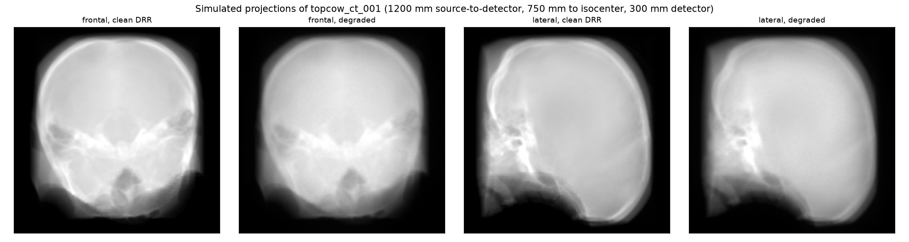
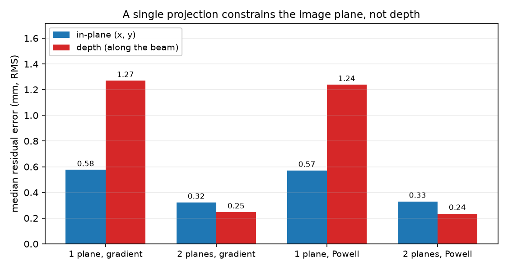
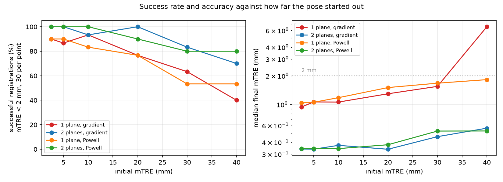
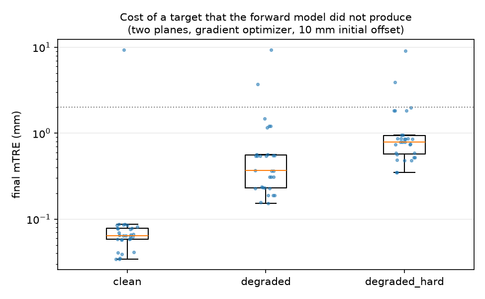
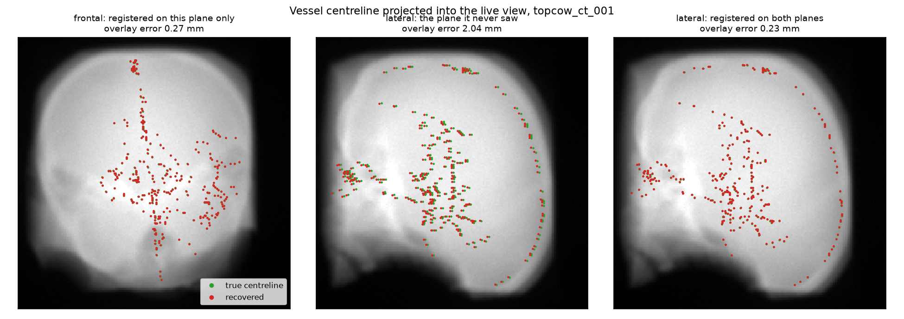

# neurovascular-2d3d-registration

Registering a head CT angiography volume to simulated X-ray projections: a differentiable
digitally reconstructed radiograph (DRR) renderer in PyTorch, 2D/3D rigid pose recovery by gradient
descent through it, and the vessel centreline projected into the recovered view the way a planning
overlay would be. Built on a public dataset, with unit tests and continuous integration.

I built this because my imaging work is volumetric MRI, where registration means aligning one
volume to another, and I wanted to understand the projective version of the problem properly: an
X-ray forward model, a pose recovered from a 2-D image, and error quoted in millimetres at a
target rather than as a similarity score. The question the study actually answers is how far the
pose can start out before registration stops finding its way back, and where the error that
remains is hiding.

The short answer is that it hides in depth. A single projection pins down the two directions in
the image plane and barely constrains the third, so the residual error of a single-view
registration is mostly along the beam. Adding a second plane at 90 degrees, which is what a
biplane neuro angiography system gives you, removes it.

## Data

**TopBrain Challenge Data Release** (Zenodo record 21972006), derived from the TopCoW challenge:
25 head CT angiography scans with voxel-level labels of the vessels of the circle of Willis. Only
the CT angiography cases and their vessel labels are used. The data is not redistributed here; see
[PROVENANCE.md](PROVENANCE.md) for the terms of use, the exact archive and checksum, and what is
committed.

Each case is reoriented, resampled to 1 mm isotropic voxels, and cropped to a 180 mm cube centred
on the vessel label, which puts the circle of Willis near the isocenter. The vessel label is
skeletonized and up to 300 centreline points are kept; those points are the targets that every
error in this repository is measured on.

## Method

**Forward model** ([nvreg/render.py](nvreg/render.py)). Hounsfield units are converted to linear
attenuation at a single effective energy near 70 keV, and each detector pixel integrates
attenuation along the ray from the source, sampled with `grid_sample` after the ray is mapped into
volume space by the inverse pose. Rays are clipped to the segment between the source and the
detector plane and bracketed against the volume's bounding sphere, so the step size adapts to each
ray's chord. Because the sampling grid is a differentiable function of the pose, so is the image.

This is a from-scratch implementation of a well-established idea rather than a new one.
Differentiable DRR rendering in PyTorch is what DiffDRR does (Gopalakrishnan & Golland, 2022), and
it uses a vectorized Siddon traversal where this uses trilinear ray marching with an adaptive step,
trading some exactness in path length for a simpler gradient path.

**Geometry** ([nvreg/geometry.py](nvreg/geometry.py)). Cone beam with the isocenter at the origin,
1200 mm source-to-detector and 750 mm source-to-isocenter, and a flat detector 300 mm across, in
the range quoted for interventional angiography systems. That geometry magnifies by 1.6 and puts
188 mm of anatomy in the field of view at the isocenter, which is what keeps the whole vessel tree
inside the image. A second plane is a view rotated 90 degrees about the patient axis; its rotation
is composed onto the object pose as a matrix, never round-tripped through an axis-angle vector.

**Target realism** (`degrade` in [nvreg/render.py](nvreg/render.py)). Registering to the
renderer's own clean output would be measuring the optimizer against its own forward model, so the
target gets a Beer-Lambert conversion to intensity, a wide-kernel scatter floor, detector blur, and
Poisson quantum noise before registration sees it. This is a stand-in for projection physics, not a
simulation of it.

**Registration** ([nvreg/register.py](nvreg/register.py)). The loss is one minus the normalized
cross-correlation of Sobel gradient magnitudes, averaged over the available planes, on a
coarse-to-fine pyramid at a quarter, a half, and full detector sampling. Two optimizers run over
the same loss: Adam stepping the six pose parameters through the differentiable renderer, and
Powell's derivative-free search from SciPy as a baseline. Rotation and translation are optimized in
scaled units (0.1 rad and 10 mm per unit) so that one step size suits both.

**Protocol** ([scripts/20_run_registration.py](scripts/20_run_registration.py)). Each target is
rendered at a known, case-specific pose, so the true pose is known exactly. The pose is then
displaced so that the mean target registration error (mTRE) over the centreline points takes a
prescribed value, found by bisection, which is what makes offsets comparable between cases of
different size. Accuracy is mTRE and success is mTRE below 2 mm, following the standardized
evaluation methodology for 2D/3D registration (van de Kraats et al., 2005). The residual is also
split into its in-plane and depth components, because a single mTRE number hides which of the two
went wrong.
## Results

720 registrations: 10 CT angiography cases, six initial offsets from 2.5 to 40 mm, three restarts
each, against degraded targets, for each combination of one or two imaging planes and the two
optimizers. The exact geometry, schedules, and seeds are in
[`outputs/registration_config.json`](outputs/registration_config.json); the headline numbers are in
[`outputs/summary.json`](outputs/summary.json).



**The error of a single view lives in depth.** Registered on one plane, the median residual is
0.58 mm across the image plane and 1.27 mm along the beam. Add a second plane at 90 degrees and the
ordering reverses: 0.32 mm in-plane against 0.25 mm in depth. Depth stops being the weak axis
because the other plane sees it side-on.



| configuration | success (mTRE < 2 mm) | median mTRE | in-plane | depth | overlay error | renders | seconds |
|---|---|---|---|---|---|---|---|
| 1 plane, gradient | 75.0% | 1.28 mm | 0.58 mm | 1.27 mm | 0.70 mm | 240 | 2.1 |
| 1 plane, Powell | 74.4% | 1.30 mm | 0.57 mm | 1.24 mm | 0.70 mm | 715 | 3.5 |
| 2 planes, gradient | 91.1% | 0.38 mm | 0.32 mm | 0.25 mm | 0.48 mm | 480 | 4.1 |
| 2 planes, Powell | 91.7% | 0.38 mm | 0.33 mm | 0.24 mm | 0.50 mm | 1417 | 6.8 |

Overlay error is the mean distance between where the centreline projects under the true pose and
under the recovered one, measured at the detector, which is the error an operator would see in the
live image rather than the error in space.

**Capture range.** Success rate against how far the pose started out, 30 registrations per cell:

| | 2.5 mm | 5 mm | 10 mm | 20 mm | 30 mm | 40 mm |
|---|---|---|---|---|---|---|
| 1 plane, gradient | 90% | 87% | 93% | 77% | 63% | 40% |
| 1 plane, Powell | 90% | 90% | 83% | 77% | 53% | 53% |
| 2 planes, gradient | 100% | 100% | 93% | 100% | 83% | 70% |
| 2 planes, Powell | 100% | 100% | 100% | 90% | 80% | 80% |



Two things are worth reading off that table rather than from the averages. First, the accuracy of
the runs that succeed barely moves with the initial offset: the two-plane median goes from 0.34 mm
at 2.5 mm to 0.56 mm at 40 mm. The failure mode is not gradual drift, it is falling into a
different minimum. Second, and for the same reason, **the mean is a bad summary here**: at a 20 mm
offset the two-plane Powell mean is 5.02 mm against a median of 0.38 mm, because one run out of 30
finished 52.6 mm away. Everything in the table above is a median, paired with the success rate that
says how often the median is the right thing to look at.

Within 20 mm the curves are flat enough that the first version of this sweep, which stopped at
20 mm, never found the edge; 30 and 40 mm were added for that reason.

**Differentiating the renderer buys cost, not accuracy.** With two planes the gradient optimizer
and the derivative-free baseline are indistinguishable in accuracy (0.375 against 0.377 mm median,
91.1% against 91.7% success), but the gradient path gets there in a third of the renders and about
60% of the wall-clock time. With a single plane it also degrades more gracefully as the offset
grows, which fits the geometry: where the loss is nearly flat in depth, a coordinate search has
nothing to stop it wandering, while a gradient step of nearly zero leaves the parameter where it
was. Powell is given a smaller iteration budget per pyramid level, so this is not a matched-budget
comparison; the render counts are reported so the cost is visible either way.

**What a less convenient target costs.** Registering against the renderer's own clean output gives
a median of 0.065 mm, which is the number not to quote. Adding quantum noise, detector blur, and a
scatter floor takes it to 0.368 mm, and a harder degradation with a quarter of the photons and
twice the scatter to 0.791 mm, while success stays at 93%. So the accuracy survives roughly an
order of magnitude of model mismatch, and a real fluoroscopic frame is a larger mismatch than this.



**What it looks like in the view.** Starting 9.6 mm out on one case, the single-plane registration
ends 0.21 mm off in the image plane and 1.26 mm off in depth. On the plane it was given, the
overlay looks right, 0.27 mm. On the plane it never saw, the same pose puts the centreline 2.04 mm
from where it belongs. Registered on both planes, that drops to 0.23 mm.


## Run it

```bash
python3 -m venv .venv && source .venv/bin/activate
pip install -r requirements.txt

# Download the data (1.8 GB) from Zenodo and unpack it. Terms of use in PROVENANCE.md.
mkdir -p data/topbrain && curl -L -o data/topbrain/TopBrain.zip \
  "https://zenodo.org/records/21972006/files/TopBrain_Data_Release_Batches1n2nTA36_081726.zip?download=1"
unzip -q data/topbrain/TopBrain.zip -d data/topbrain/extracted

./run_all.sh          # prepare -> sweep -> realism check -> tables and figures
python -m pytest -q   # tests run on analytic phantoms, no data needed
```

The sweep takes about 50 minutes on an Apple M-series GPU and roughly five times that on CPU.
`scripts/20_run_registration.py --help` exposes the case count, offsets, repeats, detector
sampling, and similarity measure.

## Tests

The renderer is checked against path lengths that can be worked out by hand rather than against
stored output, because a DRR pipeline that is only self-consistent will register beautifully to its
own projections and still be wrong about the world. A uniform sphere of radius R reads `mu * 2R`
down its central ray, an off-axis ray reads the shorter chord divided by the cosine of its angle, a
slab reads `mu * thickness`, and a volume translated out of the beam reads zero. The rest covers
rotation orthonormality and the gradient at zero rotation, detector geometry and magnification,
pose and view composition, similarity invariances, the error measures, centreline extraction
against a tube with a known axis, and that registration recovers a known pose on a phantom. All of
it runs on synthetic volumes, so continuous integration needs none of the data.

## Limitations

The honest summary is that this measures registration against a simulated projection, and a real
fluoroscopic image is a harder target than the degraded DRR used here.

- **The target comes from the same forward model.** `degrade` adds noise, blur, and a scatter
  floor, but it does not add what actually separates a DRR from a fluoroscopic frame: real scatter,
  a polychromatic spectrum and beam hardening, detector response, the patient having moved between
  the pre-procedural CT and the procedure, contrast injection dynamics, and interventional devices
  in the field that are not in the CT. These numbers are an upper bound on what the same code would
  do against real images.
- **Single effective energy.** Hounsfield units map to attenuation at one energy, so there is no
  beam hardening and dense bone is overweighted relative to a real spectrum.
- **Rigid only.** The head is the case where a rigid model is closest to true, but vessels still
  move with pulsatility and with the device.
- **Not real time.** A two-plane registration here costs about 480 renders and a few seconds on a
  laptop GPU. A system in the angiography suite needs a pose in a fraction of a second, which is
  what learned pose initialization, GPU-resident volumes, and a tighter pyramid are for. None of
  that is here.
- **Perturbations are applied by adding to the axis-angle vector**, which is not a proper
  composition of rotations. The magnitude is calibrated by bisection against the resulting mTRE, so
  the displacement is exact, but the distribution over directions is not uniform.
- **Targets are circle-of-Willis centreline points**, a small central region. Error at targets
  nearer the edge of the field of view would be larger, and the 2 mm success threshold should be
  read with that in mind.
- **The optimizers do not get an equal budget.** Powell is given a smaller iteration count per
  pyramid level than Adam; renders and wall-clock time are reported per configuration so the cost
  is visible, but it is not a controlled comparison of optimizers at matched budget.
- **Ten cases**, the first ten by case ID, with four offsets and three restarts each. The
  per-configuration contrast is the robust part; individual cell rates rest on 30 registrations.
- **Detector sampling is coarse.** 1.875 mm pixels against a clinical detector's fraction of a
  millimetre. Finer sampling would change the achievable accuracy and the runtime together.

## References

van de Kraats, E. B., Penney, G. P., Tomazevic, D., van Walsum, T., & Niessen, W. J. (2005).
Standardized evaluation methodology for 2-D-3-D registration. *IEEE Transactions on Medical
Imaging, 24*(9), 1177-1189. https://doi.org/10.1109/TMI.2005.853240

Penney, G. P., Weese, J., Little, J. A., Desmedt, P., Hill, D. L., & Hawkes, D. J. (1998). A
comparison of similarity measures for use in 2-D-3-D medical image registration. *IEEE
Transactions on Medical Imaging, 17*(4), 586-595. https://doi.org/10.1109/42.730403

Siddon, R. L. (1985). Fast calculation of the exact radiological path for a three-dimensional CT
array. *Medical Physics, 12*(2), 252-255. https://doi.org/10.1118/1.595715

Gopalakrishnan, V., & Golland, P. (2022). Fast auto-differentiable digitally reconstructed
radiographs for solving inverse problems in intraoperative imaging. *Clinical Image-Based
Procedures (CLIP 2022), MICCAI workshop*. arXiv:2208.12737. https://arxiv.org/abs/2208.12737

TopBrain and TopCoW challenge data, University Hospital of Zurich, Department of Neurology.
TopBrain Challenge Data Release [Data set]. Zenodo. https://doi.org/10.5281/zenodo.21972006
